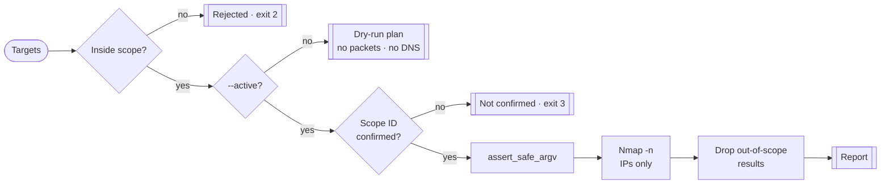

<a id="top"></a>

<div align="center">


<br>

[](https://github.com/Omarnano11498/secassess/actions/workflows/ci.yml)

-2ea043)

[](LICENSE)

**Security tooling that is safe by default and ready for a CI/CD pipeline.**<br>
A Python 3.12 command-line tool for authorized network inventory, risk analysis,<br>
static project review and hardware-health checks. Its guardrails are enforced in code.

[Highlights](#highlights) · [Design decisions](#design-decisions) · [CI/CD](#cicd) · [Quick start](#quick-start) · [Architecture](#architecture) · [Limitations](#limitations)

</div>

> [!IMPORTANT]
> Use this tool only on systems you own or are explicitly authorized to assess. Network scanning defaults to **dry-run**: no packets and no DNS queries until you pass `--active` and confirm the scope.


<a id="highlights"></a>

## Engineering highlights

| Area | What it does | Where |
|---|---|---|
| **Guardrails as code** | Targets must fall entirely within allowed CIDRs and hostnames. Active runs need a Scope ID (a 12-character SHA-256 fingerprint) bound to the exact scope and targets. Dangerous Nmap flags are rejected before every execution. | `scope.py`, `network/nmap_scanner.py` |
| **Ready for pipelines** | Non-interactive confirmation (`--confirm-scope`), a severity gate (`--fail-on high`), JSON output and documented exit codes | `cli.py` |
| **Built-in SAST** | Bandit, plus Semgrep with **local rules only** and `--metrics=off`; both degrade gracefully when missing | `project_review/reviewer.py`, `rules/semgrep-local.yml` |
| **Secrets hygiene** | Secret patterns are reported by path and line, never by value. Reports are redacted twice (JSON and Word) and written with `0600` permissions. | `redact.py`, `reporting/` |
| **Least-privilege execution** | Subprocesses run without a shell, with timeouts and a restricted environment | `runner.py` |
| **Auditability** | Append-only JSON Lines audit log: scope, enabled checks, confirmation method and outcome. It never records tool output or secrets. | `audit.py` |
| **Minimal supply chain** | The core uses only the standard library. No vulnerability data is shipped, and scans make no online queries. | `pyproject.toml`, `risk/nvd.py` |
| **Testability** | Every side effect (tools, DNS, input, privileges) is injected through `cli.Deps`. 122 tests simulate Nmap XML and send no traffic; mypy runs in strict mode; CI covers Linux and Windows. | `tests/`, `pyproject.toml` |


## Safety gates





**Never implemented:** exploitation, denial of service or stress testing, brute force, credential theft, phishing, payload delivery, detection evasion, persistence, lateral movement.
**Blocked in code:** `--script` (NSE), `-A`, `-T4/-T5`, `-D`, `-f`, `--min-rate`.
The report's "attack paths" are textual explanations only, and their status is always `explained_only_not_tested`.


<a id="design-decisions"></a>

## Design decisions

| Decision | Why | Trade-off |
|---|---|---|
| Dry-run is the default | An accidental run must never send traffic | An extra, deliberate step before every active scan |
| Scope ID = SHA-256 fingerprint (12-char prefix) of scope **and** targets | A confirmation cannot be reused after the targets change, including a stale ID left in CI | The ID has to be refreshed whenever the targets change |
| Resolve DNS once and pass Nmap IPs only (`-n`) | A DNS change between validation and scanning cannot widen the scope | Nmap never sees hostnames |
| Block risky flags in code, not just in the docs | Defense in depth: a wrong configuration or wrapper script still cannot enable them | Fewer scan features by design |
| Version-match findings are capped at `medium` confidence | Distribution backports make version matching unreliable | Matches still need manual verification |
| No dependencies in the core | Smaller attack surface; easier to audit and install | The Word report is built from scratch with the standard library |
| Unprivileged OS detection is skipped, not replaced | The tool never switches techniques silently | Less data when not running as root/Administrator |
| Documentation ranges are allowed in dry-run only | Safe demos and tests without real targets | They cannot be used to test active mode |


## Demo


<a id="quick-start"></a>

## Quick start

```bash
python3.12 -m venv .venv && source .venv/bin/activate   # Windows: .\scripts\setup.ps1
pip install -e ".[dev]"            # Core has no external dependencies; dev = pytest / ruff / mypy
pip install -e ".[all]"            # Optional: psutil + bandit

pytest                             # No network traffic, no external tools executed
secassess check-tools              # Which optional tools (Nmap, Bandit, Semgrep, smartctl) were found

secassess scope-preview -c config/example.toml -t 192.0.2.0/28            # No network, no DNS
secassess network -c config/example.toml -t 192.0.2.0/28 --json dry.json  # Dry-run plan
```


<a id="cicd"></a>

## Using it in CI/CD

This repository runs its own pipeline in [`.github/workflows/ci.yml`](.github/workflows/ci.yml):

- Ruff, mypy and pytest on Ubuntu and Windows.
- A self-scan with Bandit and the secret-pattern checks. The reports are uploaded as build artifacts.
- `permissions: contents: read` and `persist-credentials: false`, so the workflow token gets only the access it needs.
- Dependabot keeps the GitHub Actions and pip dependencies up to date.

> [!NOTE]
> The self-scan of this repository currently reports six `medium` "possible hard-coded credential" matches, all of them deliberate dummy strings in `tests/` that exercise the detector, and one `low` finding for the missing Python lockfile. With `--fail-on high` the gate passes.

**Gating a pipeline on findings.** This job reviews the project, writes one JSON report per part, and fails the build at `high` or above:

```yaml
- name: Security review gate
  run: secassess full --no-hardware --out-dir reports --fail-on high
```

**Authorized network assessment in CI.** Approve the Scope ID once from a dry-run, then pass it explicitly:

```bash
secassess network -c my-scope.toml -t 10.20.30.0/28 --active \
    --confirm-scope "$SCOPE_ID" --json report.json --fail-on high
```

| Exit code | Meaning | Typical pipeline action |
|:---:|---|---|
| `0` | Success | Continue |
| `1` | Finding at or above `--fail-on` | Fail the build |
| `2` | Configuration, scope or usage error | Fix the configuration |
| `3` | Active run not confirmed | Approval is missing or stale |
| `4` | External tool error | Check the runner image (e.g. Nmap) |
| `130` | Interrupted | Retry |


<a id="architecture"></a>

## Architecture


<details>
<summary><b>File tree</b></summary>

```
secassess/
├── .github/{workflows/ci.yml, dependabot.yml}
├── pyproject.toml
├── config/example.toml
├── scripts/{setup.ps1, full-scan.ps1}
├── src/secassess/
│   ├── cli.py, config.py, scope.py, runner.py, models.py, errors.py
│   ├── redact.py, audit.py, logging_setup.py
│   ├── network/nmap_scanner.py
│   ├── risk/{analyzer.py, advisories.py, nvd.py}
│   ├── project_review/reviewer.py
│   ├── hardware/health.py
│   ├── reporting/{report.py, docx.py}
│   └── rules/semgrep-local.yml
└── tests/   (scope, network CLI, risk, reports, project & hardware,
              config errors, Windows runner, full scan, NVD, robustness, docx)
```

Your own scope files, reports, audit logs and advisory data are excluded by `.gitignore`. Only `config/example.toml` (documentation ranges) is tracked.

</details>


## Reference

<details>
<summary><b>Network methodology and limits</b></summary>
<br>

- Phase 1: `nmap -sn` for host discovery only.
- Phase 2: `nmap -Pn -sT --top-ports N` only on hosts found to be up, with optional `-sV --version-intensity 2`.
- Defaults: `-T2`, `--max-rate 20`, `--max-retries 1`, `--host-timeout 120s`, plus a total timeout for each invocation.
- Hard caps: rate ≤ 500, ports ≤ 1000, timing template ≤ T3. TCP only.
- Public addresses require `allow_public_targets = true` **and** an allowed range. Multicast, reserved ranges and `0.0.0.0/0` are always rejected, and `max_hosts` caps the host count.
- OS fingerprinting: `--os-detect`, root/Administrator only, and the result is an estimate.

</details>

<details>
<summary><b>Finding model</b></summary>
<br>

| Type | Meaning | Confidence |
|---|---|---|
| `observed` | A directly observed fact | — |
| `inferred` | A risk inferred from an observation (e.g. Telnet ⇒ cleartext credentials) | — |
| `potential_vulnerability` | A version match against a local advisory, never treated as confirmation | `low`, or `medium` for an exact version match with no sign of a distribution package that may carry a backported fix |

Severity: info / low / medium / high / critical.

</details>

<details>
<summary><b>Local advisories from NIST NVD</b></summary>
<br>

```bash
secassess advisories fetch                                   # → advisories/nvd.json
secassess advisories fetch --product OpenSSH --min-severity high
secassess advisories show advisories/nvd.json                # Validate and summarize
```

`fetch` connects only to `services.nvd.nist.gov` and sends only public CPE identifiers. Reference the file from the configuration with `[advisories] paths = ["../advisories/nvd.json"]`. Custom JSON advisories (`schema_version: 1`) support `introduced` / `introduced_after` / `fixed` / `last_affected` bounds.

</details>

<details>
<summary><b>Project review, hardware and reports</b></summary>
<br>

```bash
secassess project ./repo --bandit --json project.json   # Read-only; the project is never executed
secassess hardware --json hw.json                        # Disk, battery, temperature
sudo secassess hardware --smart                          # Read-only SMART
secassess report network.json project.json hw.json --docx full.docx   # Merged Arabic RTL Word report
```

- **Project review:** file and language inventory (no symbolic links followed), dependency files and lockfiles, architecture inference with a stated confidence, and secret patterns.
- **Hardware:** missing data yields `overall = no_data` and is never presented as healthy. There are no stress tests and no SMART self-tests.
- **Global options:** `--log-level`, `--log-format json`, `--audit-log PATH`.

</details>

<details>
<summary><b>Windows notes</b></summary>
<br>

- `.\scripts\setup.ps1` installs every tool and builds `.venv`. `.\scripts\full-scan.ps1 -Elevate` runs as Administrator, which SMART and `--os-detect` require.
- Install Semgrep as a standalone tool: `uv tool install semgrep --python 3.13`. It is discovered automatically in `~\.local\bin`.
- Nmap and smartctl are also discovered in their default install folders. Nmap needs Npcap.
- The `0600` permission does not apply on Windows; keep reports in a folder private to your user.

</details>

<a id="limitations"></a>

## Known limitations

- Active scanning has been tried with Nmap 7.80 against `127.0.0.1` only; the automated tests simulate XML output. Try it first in an isolated lab that you own.
- TCP only, with no authenticated checks and no inspection of configuration files on remote hosts.
- Project dependencies are not checked against vulnerability databases. Pair the tool with `pip-audit` or `osv-scanner`.
- The CLI and the JSON and text reports are in English; the Word report is in Arabic.

## License

Released under the [MIT License](LICENSE).

<div align="center">
<br>

<br>
<sub>Absence of findings is not proof of security · <a href="#top">Back to top</a></sub>
</div>
