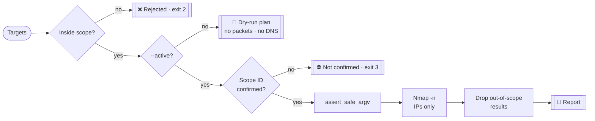
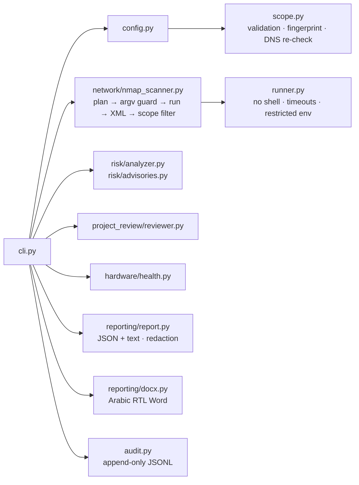
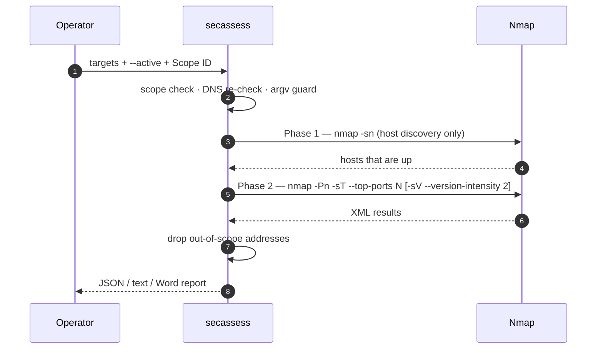

<a id="top"></a>

<div align="center">



<br>


**A Python 3.12 command-line tool for assessing systems and networks<br>that you own or are explicitly authorized to assess.**

[**Quick start**](#quick-start) ·
[**Safety**](#safety) ·
[**Architecture**](#architecture) ·
[**Usage**](#usage) ·
[**Reports**](#reports) ·
[**Limitations**](#limitations)

</div>

> [!IMPORTANT]
> Use this tool **only** on systems you own or are explicitly authorized to assess. Network scanning defaults to **dry-run**: it shows exactly what would be scanned without sending a single packet or DNS query.


## ✨ Capabilities

<table>
<tr>
<td width="25%" align="center" valign="top">

### 🛰️
**Network inventory**<br>
<sub>Nmap with conservative settings</sub>

</td>
<td width="25%" align="center" valign="top">

### 🧮
**Risk analysis**<br>
<sub>Observed services + local advisory databases</sub>

</td>
<td width="25%" align="center" valign="top">

### 🔍
**Project review**<br>
<sub>Static, read-only review of a software project</sub>

</td>
<td width="25%" align="center" valign="top">

### 🩺
**Hardware health**<br>
<sub>Local, read-only indicators</sub>

</td>
</tr>
</table>


<a id="safety"></a>

## 🛡️ Safety limits and authorization


- 🎯 Every target must fall **entirely** within `scope.allowed_cidrs`, and every hostname must be listed literally in `scope.allowed_hostnames`.
- 🔁 In active mode hostnames are resolved once, and **every** resulting address is re-checked against the scope. Nmap receives IP addresses only (with `-n`), so a DNS change cannot widen the scope.
- 🌍 Public addresses are rejected unless `allow_public_targets = true` **and** they are inside an allowed range.
- 📘 Documentation ranges (`192.0.2.0/24`, `198.51.100.0/24`, `203.0.113.0/24`, `2001:db8::/32`) are accepted in dry-run only; active mode refuses them.
- 🚫 Multicast and reserved ranges and `0.0.0.0/0` are always rejected, and the number of hosts is capped by `max_hosts`.
- 🔐 Active mode requires `--active` **and** an explicit confirmation: either typing the Scope ID interactively or passing `--confirm-scope <ID>`. The ID is a SHA-256 fingerprint of the scope and targets together, so any change to the targets invalidates the confirmation.
- 🧹 After the scan, any out-of-scope addresses returned by Nmap are dropped, and the report says so.



<details>
<summary><b>⛔ What the tool never does</b> (click to expand)</summary>
<br>

| Never | Enforcement |
|---|---|
| Run exploits, denial of service or stress testing | Not implemented |
| Brute-force, steal credentials or phish | Not implemented |
| Deliver payloads, hide or evade detection | Not implemented |
| Establish persistence or move laterally | Not implemented |
| Use the Nmap Scripting Engine (NSE) | `--script`, `-A` blocked |
| Aggressive timing, decoys, fragmentation, rate floors | `-T4/-T5`, `-D`, `-f`, `--min-rate` blocked |

All blocked options are rejected in code by `assert_safe_argv` before every execution.

> [!NOTE]
> The "attack paths" in the report are **textual explanations only**, derived from the findings. Their status is always `explained_only_not_tested`.

</details>


## 🖥️ What a dry-run looks like


<details>
<summary><b>📋 Plain-text output</b> (dry-run with Nmap available)</summary>

```
CHECKS
  [PLANNED  ] network.discovery [ACTIVE]: -n -T2 --max-rate 20 --max-retries 1 --host-timeout 120s -oX - -sn 198.51.100.0/28
      impact: Sends host-discovery probes (ICMP echo/timestamp, TCP SYN/ACK to 80/443, ...). Rate-limited.
  [PLANNED  ] network.portscan [ACTIVE]: applied only to hosts found up: ... -Pn -sT --top-ports 100 -sV --version-intensity 2 198.51.100.0/28
  [PLANNED  ] network.version_detection [ACTIVE]: -sV --version-intensity 2
  [SKIPPED  ] network.os_fingerprint: not requested (--os-detect)
FINDINGS (0)
  none (absence of findings is not proof of security)
LIMITATIONS
  - Dry-run: no packets were sent and no DNS lookups were made.
```

</details>


<a id="architecture"></a>

## 🏗️ Architecture



All side effects (running tools, DNS, interactive input, privileges) are injected through `cli.Deps`, so tests replace them with fakes.

<details>
<summary><b>🗂️ File tree</b></summary>

```
secassess/
├── pyproject.toml
├── README.md
├── .gitignore
├── config/
│   └── example.toml
├── scripts/
│   ├── setup.ps1
│   └── full-scan.ps1
├── src/secassess/
│   ├── __init__.py
│   ├── __main__.py
│   ├── cli.py
│   ├── config.py
│   ├── scope.py
│   ├── runner.py
│   ├── models.py
│   ├── errors.py
│   ├── redact.py
│   ├── audit.py
│   ├── logging_setup.py
│   ├── network/{__init__.py, nmap_scanner.py}
│   ├── risk/{__init__.py, analyzer.py, advisories.py, nvd.py}
│   ├── project_review/{__init__.py, reviewer.py}
│   ├── hardware/{__init__.py, health.py}
│   ├── reporting/{__init__.py, report.py, docx.py}
│   └── rules/semgrep-local.yml
└── tests/
    ├── __init__.py
    ├── conftest.py
    ├── test_scope.py
    ├── test_network_cli.py
    ├── test_risk.py
    ├── test_report.py
    ├── test_project_and_hardware.py
    ├── test_config_errors.py
    ├── test_runner_windows.py
    ├── test_full_scan.py
    ├── test_nvd.py
    ├── test_robustness.py
    └── test_docx_report.py
```

Your own scope files, reports, audit logs and advisory data are excluded by `.gitignore`; only `config/example.toml` (documentation ranges) is tracked.

</details>


<a id="quick-start"></a>

## 🚀 Quick start

```bash
python3.12 -m venv .venv
source .venv/bin/activate            # Windows: .venv\Scripts\activate
pip install -e ".[dev]"              # The core has no external dependencies; dev = pytest/ruff/mypy
pip install -e ".[all]"              # Optional: psutil + bandit

pytest                               # No network traffic is sent and no tool is executed
secassess check-tools                # See which optional tools were found
```

<details>
<summary><b>🧰 Optional tools</b></summary>
<br>

| Tool | Purpose | Installation | If missing |
|---|---|---|---|
| Nmap | Inventory of hosts, ports and services | `apt install nmap` / `brew install nmap` / Windows installer with Npcap | Network scan is skipped and the reason is reported |
| Bandit | Static analysis of Python code | `pip install bandit` | Skipped and reported |
| Semgrep | Static analysis with **local** rules (bundled in `src/secassess/rules/semgrep-local.yml`) | `uv tool install semgrep --python 3.13` (or `pipx install semgrep`) | Skipped and reported |
| smartctl | SMART disk health | `apt install smartmontools` / `brew install smartmontools` | Marked "unavailable" |
| psutil | Cross-platform battery and temperature | `pip install psutil` | sysfs is used on Linux, otherwise marked "unsupported" |

</details>

<details>
<summary><b>🪟 Running on Windows (PowerShell)</b></summary>
<br>

```powershell
.\scripts\setup.ps1                          # Easiest: installs every tool and builds .venv (replaces the next three lines)
py -3.12 -m venv .venv                       # Or: uv venv
.\.venv\Scripts\Activate.ps1                 # If refused: Set-ExecutionPolicy -Scope CurrentUser RemoteSigned
pip install -e ".[dev,all]"

pytest
secassess check-tools
secassess scope-preview -c config\example.toml -t 192.0.2.0/28
secassess network -c config\example.toml -t 192.0.2.0/28 --json dry.json
Copy-Item config\example.toml my-scope.toml  # Instead of cp
secassess project . --bandit --json project.json
secassess hardware --json hw.json
```

- **Full scan on Windows:** `.\scripts\full-scan.ps1` runs `secassess full` from the virtual environment, and `-Elevate` relaunches it as Administrator (required for SMART and `--os-detect`). Any other arguments are passed through unchanged, for example: `.\scripts\full-scan.ps1 -Elevate -c my-scope.toml -t 10.20.30.0/28`.
- **Do not copy `.venv` between computers:** its paths are tied to the machine it was created on. If you see `uv trampoline failed to spawn Python child process`, run `.\scripts\setup.ps1`.
- **Semgrep:** it currently does not work inside a Python 3.15 environment (incompatible protobuf library), so install it as a standalone tool: `uv tool install semgrep --python 3.13`. It is discovered automatically in `~\.local\bin` even if that is not on `PATH`.
- There is no `sudo` on Windows: for `--os-detect` and `hardware --smart`, open PowerShell with **Run as Administrator** and run the same command without `sudo`.
- You can run the tool without activating the environment: `.\.venv\Scripts\secassess.exe ...`. Tools installed inside the environment (such as bandit) are discovered automatically.
- If Nmap or smartctl is not on `PATH`, the program also looks in `C:\Program Files (x86)\Nmap` and `C:\Program Files\smartmontools\bin`. Nmap needs Npcap (included with its installer).
- The `0600` permission on report and log files does not apply on Windows; files inherit the folder's permissions, so keep them in a folder private to your user.

</details>


<a id="usage"></a>

## 📖 Usage

> [!TIP]
> Click any step to expand it. Start with steps 1–2: they never touch the network.

<details open>
<summary><b>1 · Preview the scope</b> — no network, no DNS</summary>

```bash
secassess scope-preview -c config/example.toml -t 192.0.2.0/28
```
</details>

<details>
<summary><b>2 · Dry-run</b> — the default mode</summary>

```bash
secassess network -c config/example.toml -t 192.0.2.0/28 -t web01.example.com --json dry.json
```
</details>

<details>
<summary><b>3 · Authorized active assessment</b></summary>

```bash
cp config/example.toml my-scope.toml     # Set allowed_cidrs to a range you own, e.g. 10.20.30.0/24
secassess network -c my-scope.toml -t 10.20.30.0/28              # Read the plan and the scope_id
secassess network -c my-scope.toml -t 10.20.30.0/28 --active     # Interactive confirmation
secassess network -c my-scope.toml -t 10.20.30.0/28 --active \
    --confirm-scope <SCOPE_ID> --json report.json --fail-on high # Non-interactive (CI)
```

**OS fingerprinting** (optional, needs root/Administrator; the result is an estimate):

```bash
sudo secassess network -c my-scope.toml -t 10.20.30.5 --active --os-detect
```
</details>

<details>
<summary><b>4 · Review a local project</b> — the project is never executed</summary>

```bash
secassess project ./path/to/repo --bandit --json project.json
secassess project ./path/to/repo                       # Semgrep runs by default with the bundled rules if installed
secassess project ./path/to/repo --semgrep-config ./rules/local.yml   # Your own rules
secassess project ./path/to/repo --no-semgrep          # Disable Semgrep
```
</details>

<details>
<summary><b>5 · Local hardware indicators</b></summary>

```bash
secassess hardware --json hw.json
sudo secassess hardware --smart       # Read-only SMART
```
</details>

<details>
<summary><b>6 · Full scan with every tool</b> — one JSON per part + one Word report in <code>reports/</code></summary>

```bash
secassess full                                                   # Current project + hardware with SMART
secassess full -c my-scope.toml -t 10.20.30.0/24                 # + local network (dry-run)
secassess full -c my-scope.toml -t 10.20.30.0/28 --active --confirm-scope <SCOPE_ID>
secassess full --project ./path/to/repo --no-smart --docx out.docx
# Options: --no-project --no-hardware --no-bandit --no-semgrep --no-smart --semgrep-config FILE --out-dir DIR --fail-on high
```
</details>

<details>
<summary><b>7 · Word report (.docx)</b></summary>

```bash
secassess hardware --docx hw.docx                     # Word report for one command (network/project/hardware)
secassess network -c config/example.toml -t 192.0.2.0/28 --quiet --json reports/network.json
secassess project . --bandit --quiet --json reports/project.json
secassess hardware --smart --quiet --json reports/hardware.json
secassess report reports/network.json reports/project.json reports/hardware.json --docx reports/full.docx
```
</details>

**Global options:** `--log-level`, `--log-format json` (structured logs on stderr), `--audit-log PATH`.

### 🚦 Exit codes

| Code | Meaning |
|:---:|---|
| `0` | 🟢 Success |
| `1` | 🟠 There is a finding at or above the `--fail-on` level |
| `2` | 🔴 Configuration, scope or usage error |
| `3` | 🔒 Active run was not confirmed |
| `4` | 🧰 External tool error (e.g. Nmap missing in active mode, or an Nmap scan failing during execution) |
| `130` | ⏹️ Interrupted |


## 🌐 Network methodology and controls



| Setting | Default | Hard cap |
|---|---|---|
| Timing template | `-T2` | ≤ `T3` |
| Packet rate | `--max-rate 20` | ≤ 500 |
| Ports | `--top-ports N` | ≤ 1000 |
| Retries / host timeout | `--max-retries 1` · `--host-timeout 120s` | plus a total timeout for each invocation |

- If OS fingerprinting is requested without privileges it is skipped and reported; it is **not replaced** by another technique.
- TCP only; UDP services (such as SNMP and DNS) are out of scope for this release.

## 🧭 Finding classification

Every finding carries a **severity** (info / low / medium / high / critical), a **confidence** (low / medium / high) and a **type**:

| Type | Meaning | Confidence |
|---|---|---|
| `observed` | A directly observed fact | — |
| `inferred` | A risk inferred from an observation (e.g. Telnet ⇒ cleartext credentials) | — |
| `potential_vulnerability` | A version match against a local advisory — **never treated as confirmation** | `low`, or `medium` for an exact version match with no sign of a distribution package that may carry a backported fix. Never `high`. |

<details>
<summary><b>📦 Local advisory files</b></summary>
<br>

The tool **ships no vulnerability data**, but it can build a local file from the official NIST NVD database (it connects only to `services.nvd.nist.gov` and sends only public CPE identifiers):

```powershell
secassess advisories fetch                         # All known services → advisories/nvd.json (takes several minutes)
secassess advisories fetch --product OpenSSH --product "Apache httpd" --min-severity high
secassess advisories fetch --list-products          # Supported Nmap product names and their CPEs
secassess advisories show advisories/nvd.json      # Validation and summary by product and severity
$env:NVD_API_KEY = "<your key>"                    # Optional: faster download (free key from NVD)
```

Then add the path to your configuration file (relative paths are resolved from the location of that file). For a configuration file stored in `config/`, use `paths = ["../advisories/nvd.json"]`. Update the file periodically by running `fetch` again.

You can also add your own files to `[advisories] paths` in this format:

```json
{
  "schema_version": 1,
  "source": "Description of the data source",
  "advisories": [
    {
      "id": "VENDOR-2024-0001",
      "product": "ExampleServer",
      "affected": [{"introduced": "1.0", "fixed": "1.4.2"}],
      "versions": ["1.4.1"],
      "severity": "high",
      "summary": "Short description",
      "remediation": "Upgrade to 1.4.2 or later",
      "references": ["https://vendor.example/advisory"]
    }
  ]
}
```

`product` is compared case-insensitively with the product field returned by Nmap. The `fixed` bound is exclusive, `introduced_after` (an alternative to `introduced`) is also exclusive, and `last_affected` (an alternative to `fixed`) is inclusive.

</details>


## 🔍 Software project review

The review is read-only. It covers:

- [x] Inventory of files and languages (without following symbolic links; skipping `.git`, `node_modules`, `venv` and others)
- [x] Dependency files: `requirements*.txt`, `pyproject.toml`, `package.json`, `go.mod`, `Cargo.toml`
- [x] Presence of lockfiles
- [x] Architecture inference with a stated confidence
- [x] Secret patterns — **values are never written to the report**, only the path and line number
- [x] Semgrep with a local rules file only, run with `--metrics=off`

> [!NOTE]
> Scanning the tool's own repository reports a "Possible generic hard-coded credential" finding in a test file; it is a deliberate dummy string used to test the detector.

## 🩺 Hardware-health indicators

| Indicator | 🐧 Linux | 🍎 macOS | 🪟 Windows |
|---|:---:|:---:|:---:|
| Filesystem capacity *(not a health indicator)* | ✅ | ✅ | ✅ |
| Battery wear versus design capacity | sysfs | ❌ | ❌ |
| Charge percentage *(not a health indicator)* | psutil | psutil | psutil |
| Temperature | psutil/sysfs | Usually unavailable | Usually unavailable |
| SMART | smartctl (root) | smartctl | smartctl (Administrator) |

- Statuses: `ok`, `warning`, `critical`, `inconclusive`, `unavailable`, `unsupported`, `error`. Every reading carries its source and timestamp.
- Missing data yields `overall = no_data` ("health unknown") and is never presented as healthy. Capacity and charge readings do not count as health indicators.
- There is no remaining-lifetime estimate, no stress or write tests, and no SMART self-tests.
- Remote checks (SNMP) exist in this release **as an interface only** (`RemoteHardwareSource`), with no implementation.


<a id="reports"></a>

## 📄 Reports and audit log

<details open>
<summary><b>📝 Word (.docx)</b> — Arabic, right-to-left</summary>
<br>

`--docx PATH` for any of network/project/hardware, or `secassess report <json...> --docx PATH` to merge several JSON reports into one document. It includes the executive summary, tools, scope, checks, hosts, findings grouped by title with their locations, details of findings rated medium and above, hardware indicators, recommendations derived automatically from the data only, and the methodology and limitations. It is generated with the standard library and no dependencies, secrets are redacted again, and it is written with `0600` permissions.

</details>

<details>
<summary><b>🧾 JSON</b></summary>
<br>

`schema_version`, the scope and `scope_id`, timestamps, tool and environment versions, methodology, hosts, findings sorted by severity, explained attack paths, skipped or failed checks, errors, and limitations. Secrets are redacted and the file is written with `0600` permissions.

</details>

<details>
<summary><b>📚 Audit log</b></summary>
<br>

Append-only JSON Lines (path from `audit.log_path`, or `~/.secassess/audit.log` for the project/hardware commands). It records the scope, enabled checks, confirmation method, start, end and outcome. It does not record tool output or secrets.

</details>

<a id="limitations"></a>

## ⚠️ Known limitations

> [!WARNING]
> Active scanning has been tried with Nmap 7.80 against `127.0.0.1` only, not on a full network; the automated tests simulate XML output. Try it first in an isolated lab that you own.

- TCP only, with no authentication and no inspection of configuration files on remote hosts.
- No online vulnerability databases are queried during a scan (the only connection is the explicit `advisories fetch`), and project dependencies are not checked; use local advisory files or run tools such as `pip-audit` and `osv-scanner` separately.
- `has_raw_socket_privileges` is an estimate; on Windows, Nmap needs Npcap.
- Temperature and battery indicators on macOS and Windows are limited to what psutil provides.
- The command-line interface and the JSON and terminal reports are in English; the Word report is in Arabic.

<div align="center">
<br>

<br><br>
<sub>Built for defenders · <b>absence of findings is not proof of security</b></sub>
<br>
<a href="#top">⬆ Back to top</a>
</div>
